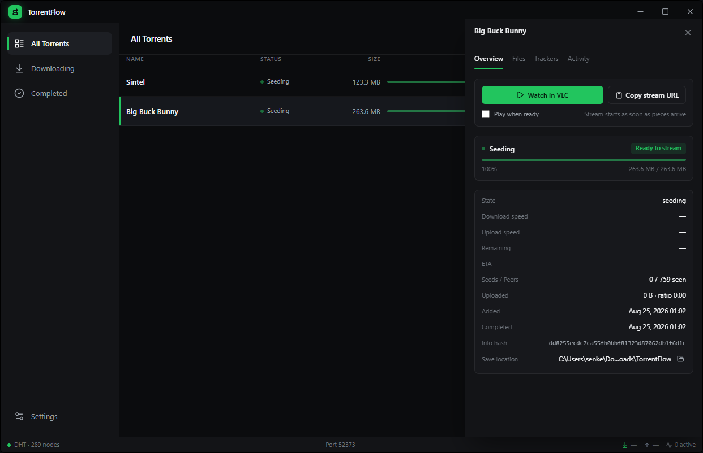
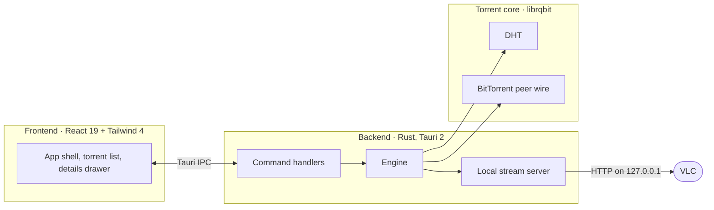

<div align="center">


# TorrentFlow

**A fast, lightweight torrent client for Windows. Stream while you download.**

[](https://github.com/senkecKG/TorrentFlow/releases/latest)
[](https://github.com/senkecKG/TorrentFlow/actions/workflows/release.yml)
[](https://github.com/senkecKG/TorrentFlow/releases/latest)
[](https://tauri.app)
[](LICENSE)

[**Download**](https://github.com/senkecKG/TorrentFlow/releases/latest) · [Website](https://senkeckg.github.io/TorrentFlow/) · [Report a bug](https://github.com/senkecKG/TorrentFlow/issues/new?template=bug_report.yml) · [Request a feature](https://github.com/senkecKG/TorrentFlow/issues/new?template=feature_request.yml)

<br />



</div>

---

## Why TorrentFlow

Most torrent clients are either ancient (2005-era UX) or bloated (Electron shells eating hundreds of MB of RAM). TorrentFlow is neither: a **native Rust app with a ~5 MB installer** and a modern interface, built for one job: getting files onto your disk fast, and letting you watch them even sooner.

No ads. No telemetry. No accounts.

## Features

| | |
|---|---|
| 🎬 **Stream while downloading** | Watch video torrents in VLC as soon as enough pieces arrive. *Play when ready*, subtitles fetched first, or copy the stream URL into any player. |
| 👁️ **Preview before you commit** | Paste a magnet and see the real name, file list and exact size before anything downloads. |
| 🎛️ **File-level control** | Pick exactly which files to download, per torrent, at any time. |
| 🛡️ **Duplicate guard** | Torrents are keyed by info-hash, so the same content is never added twice. |
| ☑️ **Batch controls** | Select many torrents and pause, resume or remove them at once. Keyboard friendly: <kbd>Space</kbd> pauses or resumes, <kbd>F</kbd> opens the folder, <kbd>V</kbd> plays, <kbd>Del</kbd> removes. |
| 📶 **Queue and limits** | Cap simultaneous downloads, set global download and upload limits, stop seeding at a ratio. |
| ⚡ **DHT native** | Trackerless magnets work out of the box, with hundreds of nodes within seconds. |
| 🪟 **At home on Windows** | System tray, start with Windows, `.torrent` and magnet link handling, keeps the PC awake while downloading or streaming, desktop notifications. |
| 🌙 **Designed dark** | Custom title bar, tabular numbers, a UI built for long sessions. |

## Install

Download the installer from [**Releases**](https://github.com/senkecKG/TorrentFlow/releases/latest) and run it:

```
TorrentFlow_x.y.z_x64-setup.exe    ~5 MB · NSIS · Windows 10/11 x64
```

Streaming uses [VLC](https://www.videolan.org/vlc/). TorrentFlow finds it automatically, or you can point to it in **Settings**.

## Build from source

**Requirements:** Node.js 20+, Rust stable, npm.

```sh
git clone https://github.com/senkecKG/TorrentFlow
cd TorrentFlow
npm install
npm run tauri dev      # development with hot reload
npm run tauri build    # production installer in src-tauri/target/release/bundle/nsis
```

## Architecture



<details>
<summary><strong>Project layout</strong></summary>

```
src/                  React frontend
  components/         UI components (list, drawer, modals, settings)
  hooks/              live torrent snapshots, click-outside
  lib/api.ts          typed Tauri IPC bridge
  lib/types.ts        shared DTO types
src-tauri/
  src/engine/         librqbit session wrapper, stream server, DTO mapping
  src/commands.rs     IPC command surface
  src/settings.rs     persisted settings
  src/vlc.rs          VLC detection and launch
  src/winint.rs       Windows integration (file associations, keep-awake)
  src/lib.rs          Tauri setup, tray, plugins
docs/                 Landing page (published with GitHub Pages)
```

</details>

## Roadmap

- [ ] Auto-updater
- [ ] Copy magnet link / export `.torrent` from the details panel
- [ ] Peer list in the details panel
- [ ] Sequential download toggle in the UI
- [ ] RSS feeds with auto-download rules
- [ ] Scheduled speed limits
- [ ] Portable (no-install) build

Have an idea? [Open a feature request](https://github.com/senkecKG/TorrentFlow/issues/new?template=feature_request.yml).

## Contributing

Issues and pull requests are welcome. See [CONTRIBUTING.md](CONTRIBUTING.md). Keep PRs small and focused, and run `npm run build` (typecheck + bundle) before submitting.

Found a security issue? Please report it privately; see [SECURITY.md](SECURITY.md).

## License

[MIT](LICENSE). Use it, fork it, ship it. Please respect copyright and the laws where you live.

<div align="center">
<br />
<sub>Built with <a href="https://tauri.app">Tauri 2</a> · <a href="https://github.com/ikatson/rqbit">librqbit</a> · React 19 · Vite 7</sub>
</div>
