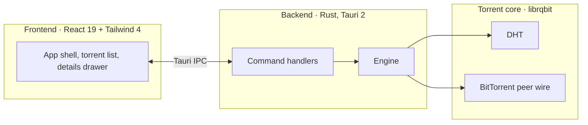

<div align="center">


# TorrentFlow

**A fast, lightweight torrent client for Windows. Stream while you download.**

[](https://github.com/seNkoKG/TorrentFlow/releases/latest)
[](https://github.com/seNkoKG/TorrentFlow/actions/workflows/release.yml)
[](https://github.com/seNkoKG/TorrentFlow/releases/latest)
[](LICENSE)
[](https://github.com/seNkoKG/TorrentFlow/stargazers)

[Download](https://github.com/seNkoKG/TorrentFlow/releases/latest) · [Website](https://senkokg.github.io/TorrentFlow/) · [Report a bug](https://github.com/seNkoKG/TorrentFlow/issues)


</div>

---

## Why TorrentFlow

Most torrent clients are either ancient (uTorrent, 2005 UX) or bloated (Electron shells eating 500 MB of RAM). TorrentFlow is neither: a **native 19 MB binary** with a modern interface, built for one job — getting files onto your disk fast, and letting you watch them even faster.

| | |
|---|---|
| 🎬 **Stream while downloading** | Watch video torrents in VLC the moment enough pieces arrive. Sequential fetching, subtitles prioritized. |
| 👁️ **Preview before you commit** | Paste a magnet, see the real name, file list and exact size before anything downloads. |
| 🛡️ **Duplicate guard** | Torrents are keyed by info-hash. The same content can never be added twice. |
| 🎛️ **File-level control** | Select exactly which files to download, per torrent, any time. |
| ⚡ **DHT native** | Trackerless magnets work out of the box — hundreds of nodes within seconds. |
| 📂 **One-click reveal** | Jump to any download in Explorer from the details panel. |
| 🌙 **Designed dark** | Custom title bar, tabular numbers, a UI built for long sessions. |

## Install

Grab the installer from [**Releases**](https://github.com/seNkoKG/TorrentFlow/releases/latest):

```
TorrentFlow_x.y.z_x64-setup.exe   (~19 MB, NSIS)
```

Windows 10/11, x64. No admin rights required for per-user installs.

## Build from source

**Requirements:** Node.js 20+, Rust stable, npm.

```sh
git clone https://github.com/seNkoKG/TorrentFlow
cd TorrentFlow
npm install
npm run tauri dev      # development with hot reload
npm run tauri build    # production installer
```

## Architecture



<details>
<summary><strong>Project layout</strong></summary>

```
src/                  React frontend
  components/         UI components (list, drawer, modals)
  lib/api.ts          typed Tauri IPC bridge
  lib/types.ts        shared DTO types
src-tauri/
  src/engine/         librqbit session wrapper + DTO mapping
  src/commands.rs     IPC command surface
  src/lib.rs          Tauri setup, plugins
docs/                 GitHub Pages landing site
```

</details>

## Roadmap

- [ ] RSS feeds with auto-download rules
- [ ] Sequential download toggle in the UI
- [ ] Speed limits and scheduling
- [ ] Portable (no-install) build

## Contributing

Issues and PRs welcome. Keep PRs small and focused; run `npm run build` (typecheck + bundle) before submitting.

## License

[MIT](LICENSE) — use it, fork it, ship it.

<div align="center">
<sub>Built with Tauri 2 · librqbit · React 19 · Vite 7</sub>
</div>
